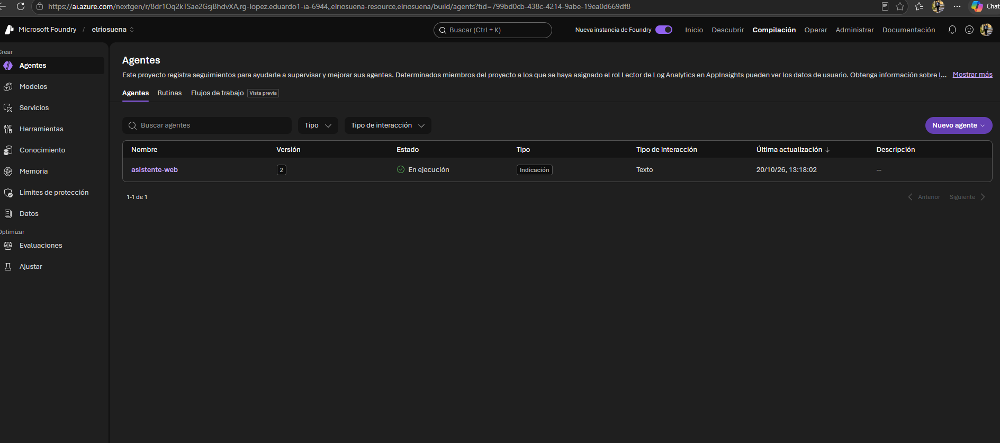
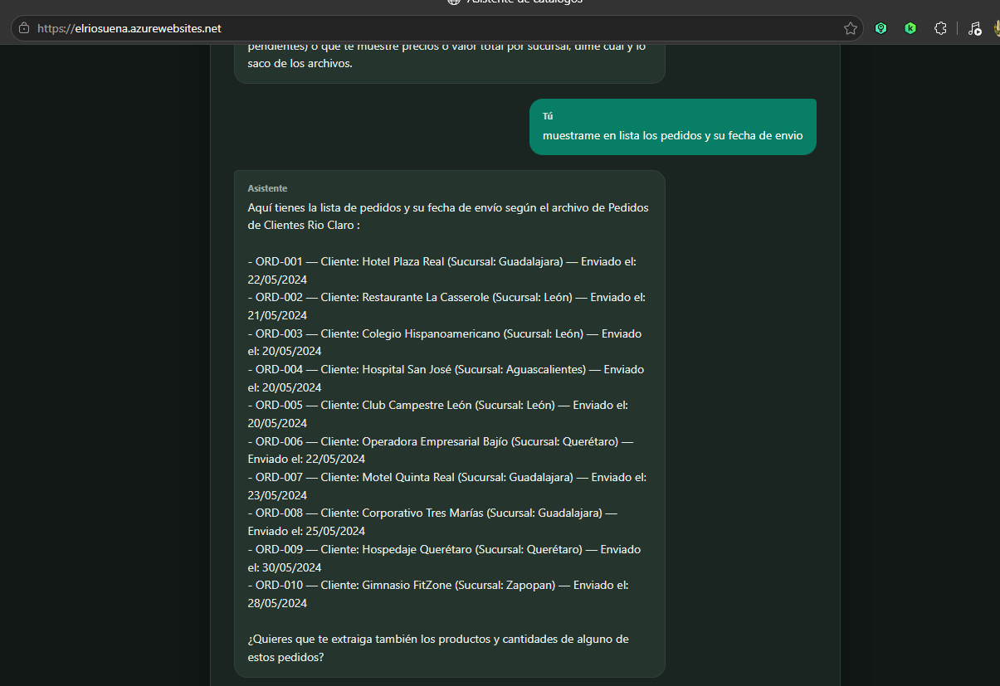
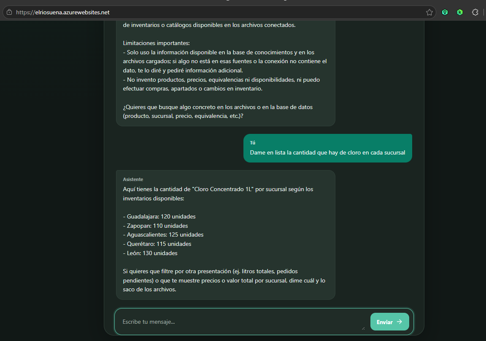
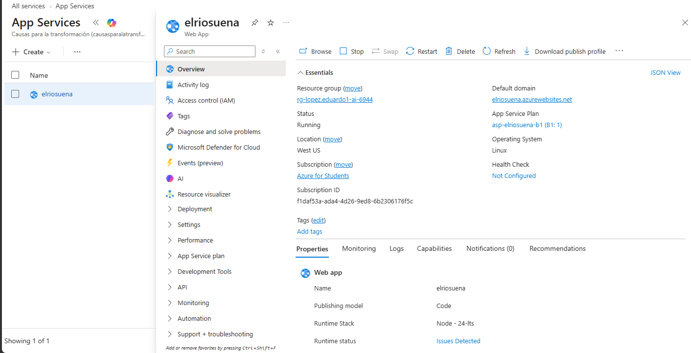
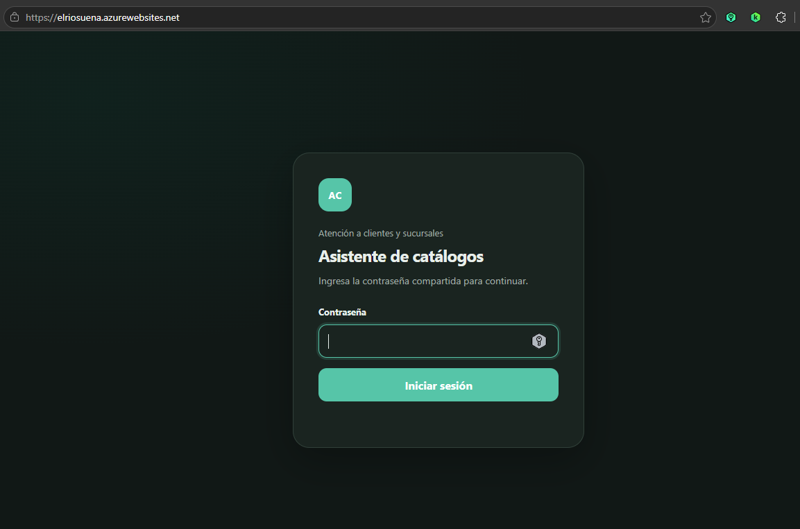
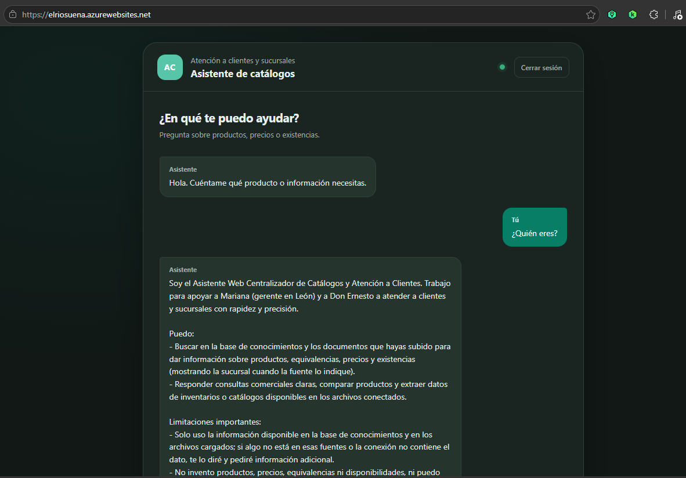
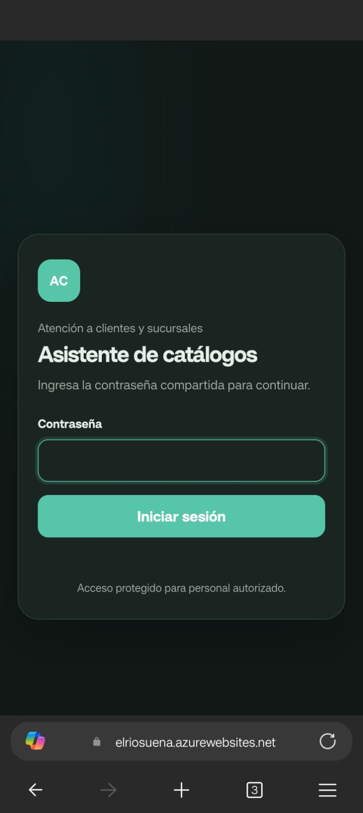
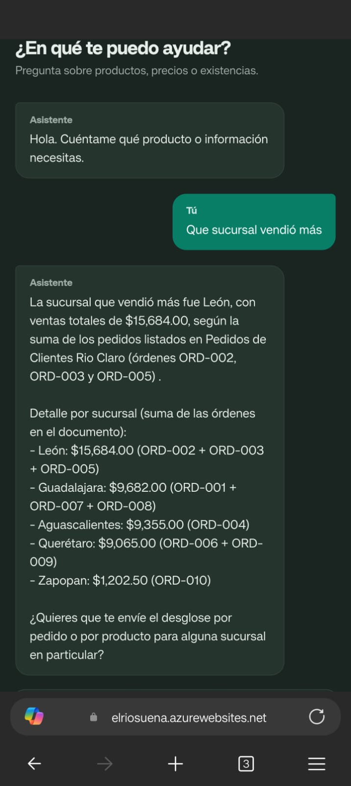
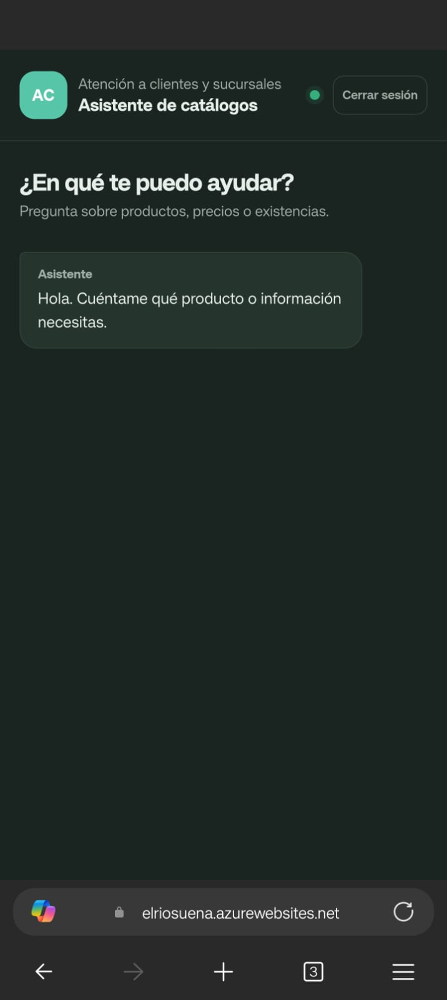

# Proyecto AI-901: Solución de IA Generativa para Distribuidora Río Claro
**Agente de Inventario Unificado y Tracking de Pedidos**

## "El Rio Suena" 

* Participante: **Eduardo López Cardona**.
* Fecha de publicación: **20 de Octubre de 2026**

---

## 1. Explicación del Problema del Negocio

**Distribuidora Río Claro** es una empresa familiar de productos de limpieza e higiene con 22 años en el mercado, 140 empleados y 5 sucursales (Guadalajara, Zapopan, León, Querétaro y Aguascalientes). Atiende a más de 1,800 clientes activos sin contar con un departamento de TI estructurado.

### Principales Puntos de Dolor Identificados:
1. **Pérdida de Clientes por Tiempos de Respuesta:** Clientes clave (hoteles y restaurantes) abandonaron la empresa debido a la falta de respuesta oportuna sobre sus pedidos y existencias.
2. **Información Descentralizada y Desordenada:** Cada sucursal maneja su propio archivo de inventario con inconsistencias de catalogación (ej. *"Cloro 1L"*, *"CLORO LITRO"* y *"Blanqueador 1000ml"* hacen referencia al mismo producto).
3. **Falta de Seguimiento Transversal:** Cuando un cliente llama a una sucursal (ej. León con Mariana) para preguntar por su pedido, el personal debe buscar en archivos locales aislados. Si el pedido proviene de otra sucursal, no hay visibilidad inmediata.
4. **Falta de Cifras Confiables para Dirección:** Don Ernesto (Director General) recibe reportes dispares entre sucursales a fin de mes, impidiéndole tomar decisiones estratégicas basadas en datos unificados.

---

## 2. Solución Propuesta

Para solucionar los problemas de **Mariana (Gerente de León)** y **Don Ernesto (Director General)**, se diseñó e implementó un **Agente Inteligente de Inventario y Tracking de Pedidos** utilizando **Microsoft Foundry** y **Azure App Service**.

### Beneficios Clave:
* **Para Mariana:** Consulta centralizada e instantánea sobre el estado de los pedidos de cualquier cliente y existencias globales en las 5 sucursales.
* **Para Don Ernesto:** Unificación del catálogo de productos y estandarización de consultas de inventario para reportes consolidados y confiables.
* **Para los Clientes:** Tiempos de respuesta reducidos de días a segundos.

---

## 3. Arquitectura e Implementación Técnica

La solución está desarrollada bajo una arquitectura web moderna, utilizando exclusivamente servicios de Azure.

```
[ Cliente / Frontend Web ] 
           │
           ▼  (POST /api/chat)
[ Express 5 Backend - Node.js 24 ] ──(DefaultAzureCredential)──► [ Microsoft Foundry ]
           │                                                           │
           ▼                                                           ▼
[ Azure App Service ]                                           [ gpt-5-mini Agent ]
                                                                       │
                                                                       ▼
                                                       [ Base de Datos de Inventarios 
                                                         y Tracking de Pedidos ]
```

### Componentes de la Solución:
1. **Frontend:** Interfaz web ligera en HTML/CSS/JavaScript accesible desde cualquier dispositivo (PC y celular).
2. **Backend (Node.js 24 + Express 5):** Servidor HTTP que expone endpoints REST (`POST /api/chat`, `GET /health`) y gestiona las conversaciones persistentes.
3. **Agente en Microsoft Foundry:** Agente configurado con el modelo `gpt-5-mini` que procesa lenguaje natural, unifica claves de productos y consulta el estado de las órdenes.
4. **Despliegue:** Alojado en **Azure App Service (B1)** con **Identidad Administrada Asignada por el Sistema** y el rol `Foundry User`  para autenticación segura sin API Keys en el código.

---

## 4. Alineación con los Principios de IA Responsable

* **Equidad:** El agente trata con el mismo nivel de precisión y rapidez las consultas de las 5 sucursales, sin sesgos por volumen de datos.
* **Confiabilidad y Seguridad:** Si el agente no encuentra el ID de un pedido o un producto en el catálogo unificado, lo indica claramente en lugar de inventar información.
* **Privacidad y Seguridad:** Se utiliza `DefaultAzureCredential` con Identidad Administrada y Entra ID, eliminando llaves o credenciales quemadas en el código.
* **Transparencia:** El sistema notifica al usuario que está interactuando con un asistente virtual impulsado por IA.
* **Inclusión:** La interfaz web está adaptada para funcionar desde teléfonos móviles para personal en movilidad o bodega.
* **Rendición de Cuentas:** La información proporcionada por el agente siempre puede ser auditada contra las fuentes de datos originales de los archivos de sucursal.

---

## 5. Conocimientos

*(En esta sección se incluye información relacionada a los conocimientos incrustados en el agente)*

**Listado de productos** 

1. **Cloro**
2. **Detergente Liquido Multiusos**
3. **Limpiador de Pisos**
4. **Desinfectante en aerosol**
5. **Jabon para manos**
6. **Gel antibacterial**
7. **Papel Higiénico**
8. **Toalla Interdoblada**
9. **Servilletas de Papel**
10. **Escoba de Uso Rudo**
11. **Trapeador**
12. **Cubeta de Plastico**
13. **Fibra Multiusos**
14. **Esponga de cocina**
15. **Guantes medianos**
16. **Guantes Grandes**
17. **Bolsa para Basura Negra**
18. **Bolsa Camiseta**
19. **Atomizador**
20. **Jalador de Agua**

**10 Pedidos**

Los diez pedidos son de diferentes sucursales. 

---

## 6. Evidencias de Funcionamiento

1. **Agente Registrado en Microsoft Foundry:**
   

2. **Interfaz del Chatbot Web (Prueba de Seguimiento de Pedidos):**
   

3. **Consulta de Inventario Unificado entre Sucursales:**
   

4. **Recurso Desplegado en Azure App Service:**
   
   
5. **Página de login:**
   

6. **Página del chat:**
   

6. **Aplicación web responsive:**
   * **Login responsive**  
      

   * **Página del chat:**  
      

   * **Página del chat:**  
    
---

## 7. Enlace del Prototipo Funcional

* **URL de la Aplicación en Producción:** `https://elriosuena.azurewebsites.net`
